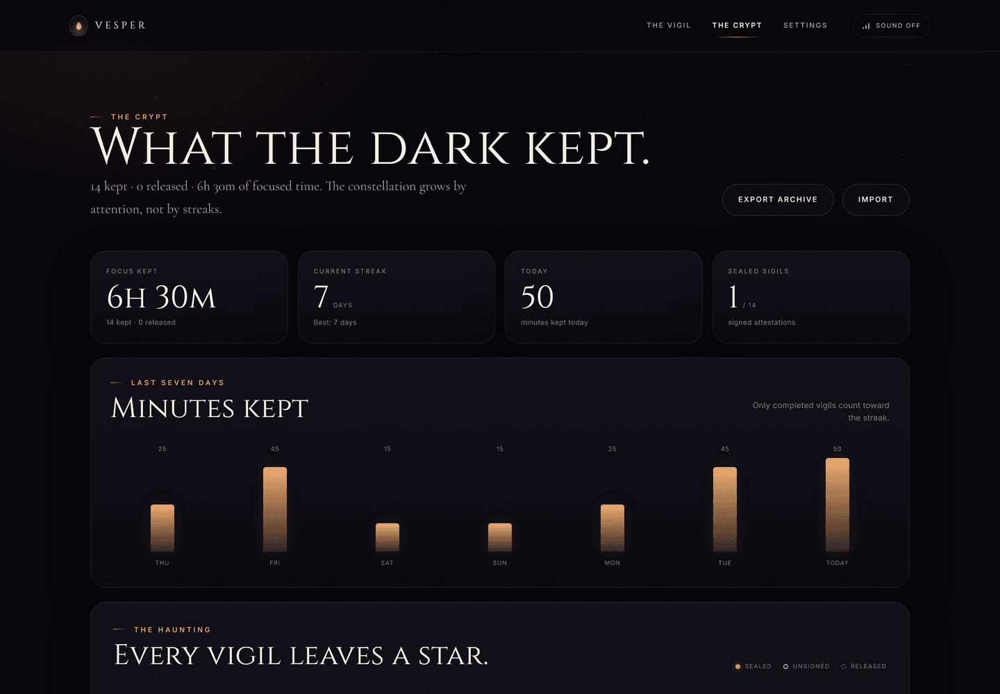

# Vesper

**Keep a vigil. Leave a sigil.**

Vesper turns deep work into a small, strange ceremony: a candle burns down while a live, procedural room of wind, rain, hearth and bells keeps time. When the hour is kept, a transmission and a deterministic sigil return with it — and a wallet signature can seal the record so anyone can verify it without trusting the app.

Built with **Kiro** (specs, steering, hooks, MCP) for **Kiroween 2026 — Vampire: Costume Contest**.

- **Live app:** _added after the first GitHub Pages deploy_
- **Demo video:** [docs/vesper-demo.mp4](docs/vesper-demo.mp4) — a 37-second captioned walkthrough recorded with Playwright (silent; the narrated storyboard is in [docs/demo-script.md](docs/demo-script.md))
- **Design notes:** [docs/architecture.md](docs/architecture.md) · [docs/web3-design.md](docs/web3-design.md)
- **How Kiro was used:** [docs/kiro-usage.md](docs/kiro-usage.md)

<p align="center">
  
  
</p>
<p align="center">
  
  
</p>

## What it does

- **The vigil** — 5–45 minute presets or a custom 1–600 minute session. The timer is derived from wall-clock time (`targetEnd`), so pausing, hiding the tab, or throttled timers cannot steal or inflate minutes. A vigil can be finished early or released; only completed time counts toward streaks.
- **A live room** — five independent synthesized channels (wind, rain, hearth, drone, bells) built with the Web Audio API. Five presets, per-channel levels, master volume, and a sound toggle. No samples, no streaming, no network.
- **Séance transmissions** — a deterministic, locally composed passage derived from the vigil's seal, intention, ambience, duration and outcome. The same vigil always yields the same words.
- **Sigils** — a deterministic SVG generated from the seal, in the app's palette, used as the vigil's mark and the contract's on-chain artwork.
- **The crypt** — total focus, current and best streak, today's minutes, sealed count, a seven-day chart, a constellation where every vigil is a star, filters, a detail page, and a transmission ledger.
- **Local-first archive** — `localStorage` with sanitisation on every read, corrupt-vault backup, JSON export/import, single-attestation download.
- **Proof of focus** — EIP-712 attestations signed by a local keeper or a browser wallet, verified in-app by signer recovery, plus a standalone verifier that imports only viem.
- **Optional registry** — an immutable, ownerless, soulbound ERC-721 (`VesperSigils.sol`) with mint-once semantics and fully on-chain base64/SVG metadata.
- **PWA** — installable, offline-capable, hash-routed, with reduced-motion support and a self-hosted font stack.

## Quick start

```bash
npm ci
npm run dev
```

Open <http://localhost:5173>. Node 20 or newer; Node 24 is used in CI.

No environment variables are required. To point the app at a deployed registry or a different chain, copy `.env.example` to `.env`:

| Variable | Default | Purpose |
| --- | --- | --- |
| `VITE_SIGIL_CONTRACT` | empty | Address of a deployed `VesperSigils`. Empty disables minting. |
| `VITE_CHAIN_ID` | `8453` | Expected chain (Base mainnet); `84532` for Base Sepolia. |
| `VITE_REPO_URL` | `https://github.com` | Repository URL used by in-app links. |

Build and preview the production bundle:

```bash
npm run build
npm run preview
```

## Scripts

| Command | What it does |
| --- | --- |
| `npm run dev` | Vite dev server. |
| `npm run build` | Typecheck, then build to `dist/`. |
| `npm run typecheck` | `tsc --noEmit`. |
| `npm test` | Unit tests (Vitest). |
| `npm run test:e2e` | End-to-end tests (Playwright, `e2e` project). |
| `npm run screenshots` | Regenerate README/crypt screenshots (Playwright, `screenshots` project). |
| `npm run demo` | Record the demo flow artifacts (Playwright, `demo` project). |
| `npm run verify:attestation -- <file>` | Verify an attestation or archive with the independent verifier. |
| `npm run icons` | Regenerate PWA icons and the OG image. |
| `npm run lint` | ESLint. |

Contracts:

```bash
cd contracts
npm ci
npm test                 # 9 passing
npx hardhat build
npx tsc --noEmit
```

## Proof of focus

A sealed vigil signs this typed message:

```
Vigil(bytes32 id, address keeper, string startedAt, uint32 durationMin, bytes32 seal)
```

- Domain: `("Vesper", "1", chainId, verifyingContract?)`.
- `id` is `keccak256` of the vigil's string id.
- `startedAt` is a digit-only decimal string. It never becomes a JavaScript `Date` inside the signed payload.
- `durationMin` is an integer from 1 to 600.
- `seal` is `keccak256("vesper.seal.v1|<id>|<startedAt>|<endedAt>|<plannedMin>|<focusedSec>|<completed|released>|<intention>|<ambience>")`.

Sealing is optional. An unsigned vigil is labelled unsealed, not "verified". The UI shows a signature as verified only after the app recovers the signer and matches the keeper.

Verify without trusting Vesper:

```bash
npm run verify:attestation -- attestation.json
npm run verify:attestation -- vesper-archive.json
```

The verifier imports `viem` only, checks the shape and domain, recovers the signer, and (for archives) recomputes the seal from the record. See [docs/web3-design.md](docs/web3-design.md) for the full threat model.

### Registry (optional)

`contracts/contracts/VesperSigils.sol` is a soulbound ERC-721 with ERC-5192 `locked()`:

- One mint per sigil id, signature-bound to the keeper.
- `approve`, `setApprovalForAll`, and every transfer path revert with `Soulbound()`.
- No owner, proxy, burn, or upgrade path.
- `tokenURI` is self-contained base64 JSON with an inline SVG; both strings are escaped.

The contract is tested but **not audited and not deployed** in this release. Deployment is an operator action:

```bash
cd contracts
BASE_SEPOLIA_RPC_URL=... DEPLOYER_PRIVATE_KEY=... npm run deploy:baseSepolia
```

Keys are read from the environment only. Never write them to a file. Set `VITE_SIGIL_CONTRACT` and `VITE_CHAIN_ID=84532` to enable minting in a build.

## Architecture

```text
src/
  views/        Landing, Vigil, Return, Crypt, Settings
  components/   Nav, Sigil, Candle, Backdrop, ConfirmDialog, ToastStack, ErrorBoundary
  state/        AppContext (vault, timer, wallet, routing, audio)
  hooks/        useVault, useVigilTimer, useWallet
  lib/          timer, attestation, wallet, storage, transmissions, sigil, stats, audio, time, files, hash
  styles/       tokens, layout, components, motion
public/         manifest, service worker, icons, OG image
contracts/      Hardhat 3 + viem + OpenZeppelin soulbound registry
.kiro/          specs, steering, hooks, MCP
scripts/        independent verifier, Kiro hook scripts, icon generation
```

- **No backend.** Nothing is uploaded; there are no analytics or remote assets.
- **Pure core.** Timer, seal, transmission, sigil, stats and sanitisation live outside React and are unit-tested.
- **Honest recovery.** The UI distinguishes sealed/verified, sealed/unverifiable, and unsealed.
- **Offline.** A custom service worker precaches the build, handles navigation fallback, and ignores encoding-sensitive `Vary` headers for same-origin assets.

More detail: [docs/architecture.md](docs/architecture.md).

## Built with Kiro

| Capability | Where |
| --- | --- |
| Spec-driven development | `.kiro/specs/vigil-core/`, `.kiro/specs/proof-of-focus/` |
| Steering | `.kiro/steering/` — product, tech, structure, design system, Web3 security, submission and demo playbooks |
| Agent hooks | `.kiro/hooks/` — typecheck on save, contract tests on save, verification after spec tasks, secret/publish guard, session briefs, post-compaction reminder |
| MCP | `.kiro/settings/mcp.json` — Playwright for browser verification |
| Portable agent rules | `AGENTS.md`, `contracts/AGENTS.md` |

The three hooks worth knowing:

- `guard-secrets` blocks `.env`/key writes, secret reads, unapproved pushes and releases, testnet/mainnet deploys, and force pushes. The hook exits with code 2 and explains why.
- `spec-task-verify` runs typecheck, app tests and contract tests after each spec task.
- `typecheck-on-save` keeps TypeScript honest while editing.

Full write-up, including the spec → code traceability table and the PWA debugging loop: [docs/kiro-usage.md](docs/kiro-usage.md). Real session captures belong in [docs/kiro-evidence/](docs/kiro-evidence/README.md); they are never mocked.

## Deployment

GitHub Actions builds and publishes `dist/` to GitHub Pages on every push to `main`:

1. Create a public repository and push `main`.
2. In **Settings → Pages**, set the source to **GitHub Actions**.
3. The workflow runs tests, builds with `VITE_REPO_URL` derived from the repository, and deploys.
4. Optionally set repository variables `VITE_CHAIN_ID` and `VITE_SIGIL_CONTRACT` for on-chain minting.

The Vite base is `./`, so the app works from a project subpath. Hash routing means no server rewrite is required.

## Accessibility and privacy

- Semantic landmarks, focus-visible styles, skip link, labelled controls, live regions for timer state and toasts.
- Respects `prefers-reduced-motion` and offers a Reduce motion setting.
- Colour contrast is checked for body copy and controls on the dark palette.
- Audio is opt-in; the app starts silent until the sound control is pressed.
- Intentions, archives, signatures and local keeper keys never leave the browser.

## Limitations

- The registry is unaudited; use a testnet first.
- The local keeper stores its private key unencrypted in `localStorage` for low-friction test vigils. Do not use it with funds.
- Sealing proves the keeper signed the record, not that the device clock was honest.
- Signatures cannot be revoked; an exported attestation remains valid evidence.
- This release ships verification locally; on-chain minting is optional and not yet deployed.

## Licence

MIT — see [LICENSE](LICENSE). Fonts are self-hosted from Fontsource (SIL Open Font License). The app contains no sampled audio; all sound is synthesized at runtime.
