# How Kiro Was Used

Vesper was developed with Kiro's spec-driven workflow, steering documents, agent hooks, and MCP. This page records what exists in the repository, how each Kiro capability changed the build, and where to find the evidence. It deliberately avoids inventing chat transcripts: captures live in [`docs/kiro-evidence/`](kiro-evidence/README.md) and must be supplied from the real session.

## At a glance

| Kiro capability | Artifact in this repo | Effect on the product |
| --- | --- | --- |
| Spec-driven development | `.kiro/specs/vigil-core/`, `.kiro/specs/proof-of-focus/`, `.kiro/specs/proof-of-focus-solana/` | Requirements (EARS), design, and task plans preceded implementation; the timer and proof invariants are testable. |
| Steering | `.kiro/steering/*.md` | Persistent product voice, stack rules, file structure, design system, Web3 security, and submission constraints. |
| Agent hooks | `.kiro/hooks/*.json` | Typecheck/tests on save and task completion, secret and publishing guards, session briefs, post-compaction reminders. |
| MCP | `.kiro/settings/mcp.json` | Playwright MCP for browser verification, screenshots, console and network inspection. |
| AGENTS.md | `AGENTS.md`, `contracts/AGENTS.md` | Portable agent instructions for collaborators and other tools. |

## Spec-driven development

Three specs describe the system before and while it was built:

- **`vigil-core`** — the ritual, timer semantics, ambience, seal, transmission, sigil, archive, storage, settings, PWA, accessibility, and quality gates. Eleven requirements, each with EARS acceptance criteria.
- **`proof-of-focus`** — keeper selection, EIP-712 signing, independent verification, honest unsigned states, soulbound minting, registry invariants, chain configuration, and key hygiene. Eight requirements.
- **`proof-of-focus-solana`** — the v0.2 layer: the canonical v2 message, the encrypted local keeper, wallet signing, the soulbound Token-2022 registry, the independent verifier, clock evidence, network safety, quality gates, v1 compatibility, and truthful documentation. Ten requirements, and the only spec whose tasks include a Rust/Anchor program.

Each spec has the full triad:

| File | Purpose | Example |
| --- | --- | --- |
| `requirements.md` | EARS statements and non-goals | "WHEN the page is hidden and later shown THE SYSTEM SHALL recalculate from the clock…" |
| `design.md` | Architecture, data models, invariants, testing | The timer state machine and its four invariants. |
| `tasks.md` | Checkbox plan with requirement references | `3.4` implements auto-finish and cites Req 2.8. |

### How the loop worked

1. Write or amend the requirement before touching behaviour.
2. Update the design (especially invariants and failure modes).
3. Break the change into tasks with requirement references.
4. Implement against the task, keeping pure logic in `src/lib` so it can be tested.
5. Run the gates and mark the task only when they pass.

This is why the codebase has small pure modules with tests instead of logic embedded in views: the specs demand properties such as "pause then resume preserves remaining time" and "sanitised storage always satisfies the domain ranges".

### Traceability examples

| Requirement | Implementation | Test |
| --- | --- | --- |
| vigil-core 2.1–2.5 (clock-derived timer) | `src/lib/timer.ts` | `tests/timer.test.ts` |
| vigil-core 4.2, proof-of-focus 3.6 (seal) | `src/lib/attestation.ts` | `tests/attestation.test.ts` |
| vigil-core 5.2–5.4 (stats) | `src/lib/stats.ts` | `tests/stats.test.ts` |
| vigil-core 6.2–6.6 (storage) | `src/lib/storage.ts` | `tests/storage.test.ts` |
| proof-of-focus 2.x, 3.x (sign/verify) | `src/lib/wallet.ts`, `scripts/verify-attestation.ts` | `tests/attestation.test.ts`, CLI check |
| proof-of-focus 6.x (registry) | `contracts/contracts/VesperSigils.sol` | `contracts/test/VesperSigils.ts` |
| proof-of-focus-solana 1.x–5.x (seal v2, keeper, registry) | `src/lib/proof/`, `solana/programs/vesper-sigil/` | `tests/`, `solana/scripts/test.sh` |

## Steering

| File | Inclusion | What it enforces |
| --- | --- | --- |
| `product.md` | always | Ceremony over productivity, honest proof, local-first, voice and copy rules, non-goals. |
| `tech.md` | always | Stack, commands, environment variables, engineering rules, known constraints. |
| `structure.md` | always | Repository map, module responsibilities, routes, storage keys, naming conventions. |
| `design-system.md` | fileMatch (`src/**/*.ts`, `*.tsx`, `*.css`) | Tokens, typography, layout, component classes, motion, accessibility, copy patterns. |
| `web3-security.md` | fileMatch (`attestation.ts`, `wallet.ts`, `storage.ts`, verifier, `contracts/**`) | Ten invariants, key handling, contract and client review checklists. |
| `kiroween-playbook.md` | manual | Submission requirements, evidence rules, publishing rules, final audit. |
| `demo-capture.md` | manual | Storyboard, capture settings, ffmpeg assembly, honesty rules. |

Steering changed concrete decisions:

- **No backend.** `product.md` and `tech.md` forbid API calls, so the app uses `localStorage` and a service worker rather than sync.
- **Absolute timers.** `tech.md` requires clock-derived time, which is why snapshots store `targetEnd`.
- **Honest verification.** `web3-security.md` forbids showing "verified" before signer recovery; the UI has an explicit unverifiable state.
- **Security guardrails.** The same file keeps the contract free of owner, proxy, burn, and transfer paths.

## Agent hooks

All hooks use the v1 schema (`.kiro/hooks/*.json`).

| Hook | Trigger | Action | Why |
| --- | --- | --- | --- |
| `typecheck-on-save` | `FileSave` on `src/**/*.ts(x)` | `npx tsc --noEmit` | Catch type drift immediately. |
| `contract-tests-on-save` | `FileSave` on contracts/tests | `npm --prefix contracts test` | Every Solidity change re-runs the nine-case suite. |
| `spec-task-verify` | `PostTaskExec` | `node scripts/kiro/verify.mjs` | Typecheck + app tests + contract tests after each spec task. |
| `spec-completion-review` | `PostTaskExec` | Agent prompt | Reconcile the task with requirement numbers, checkboxes, and design. |
| `guard-secrets` | `PreToolUse` on shell and write tool IDs | `node scripts/kiro/guard-secrets.mjs` | Exit code 2 blocks `.env`/key writes, secret reads, unapproved pushes/deploys, and force pushes. |
| `session-brief` | `SessionStart` | `node scripts/kiro/session-brief.mjs` | Injects branch, commit, tree state, specs, and gates. |
| `prompt-publish-guard` | `PromptSubmit` | `node scripts/kiro/prompt-brief.mjs` | Adds the approval policy when a prompt mentions deploy/push/release/production. |
| `post-compact-reminder` | `PostCompact` | `node scripts/kiro/session-brief.mjs --post-compact` | Restores invariants after context compaction. |

The guard is intentionally narrow and deterministic. It does not try to understand intent; it blocks a short list of dangerous patterns and explains the next step. Kiro 1.x names its shell tool `execute_pwsh` on Windows (and `execute_bash` or `execute_cmd` elsewhere), so the matcher lists the real tool IDs rather than the category name. The first live run used a `shell|write` matcher that never fired; a temporary PreToolUse probe captured Kiro's payload, the matcher was corrected, and the probe was removed. `guard-block.png` is the corrected run. The scripts can be run manually:

```bash
echo '{"tool_name":"execute_pwsh","tool_input":{"command":"git push origin main"}}' | node scripts/kiro/guard-secrets.mjs
# exit 2 with an explanation
```

## MCP

`.kiro/settings/mcp.json` registers Playwright MCP in headless mode with a small auto-approve list for navigation, snapshots, screenshots, console messages, and network requests. It was used for:

- Verifying the golden path (begin → finish → return → seal → crypt) without leaving the editor.
- Capturing screenshots at desktop and mobile sizes.
- Inspecting console errors during the PWA work (cached gzip bodies, `Vary` mismatches, missing fonts offline).
- Checking network requests to confirm no third-party calls.

## Vibe coding, with guardrails

Free-form iteration was used where the spec did not prescribe a solution — audio graph design, constellation layout, copy, and the service-worker strategy. Steering kept that iteration bounded:

- The PWA needed several iterations: assets were not precached; cached responses kept `content-encoding: gzip`; `Vary` prevented cache matches; fonts referenced from CSS were missed. Each failure was reproduced in the browser, fixed in `public/sw.js`, and re-tested offline.
- The settings grid and mobile stat cards were adjusted until the layout held at 320 px and at desktop width.
- Pluralisation was corrected across views and toasts after steering flagged the copy rule.

Hooks made these loops cheaper: every source save typechecked, and every contract edit re-ran the test suite.

## Evidence

`docs/kiro-evidence/` holds captures from the real Kiro session; the README there lists the shots and the surface gaps (the Agent Hooks panel lists five of the eight hooks, so the folder shot carries the rest). Nothing here is generated or staged.

| Spec requirements | Spec design |
| --- | --- |
| 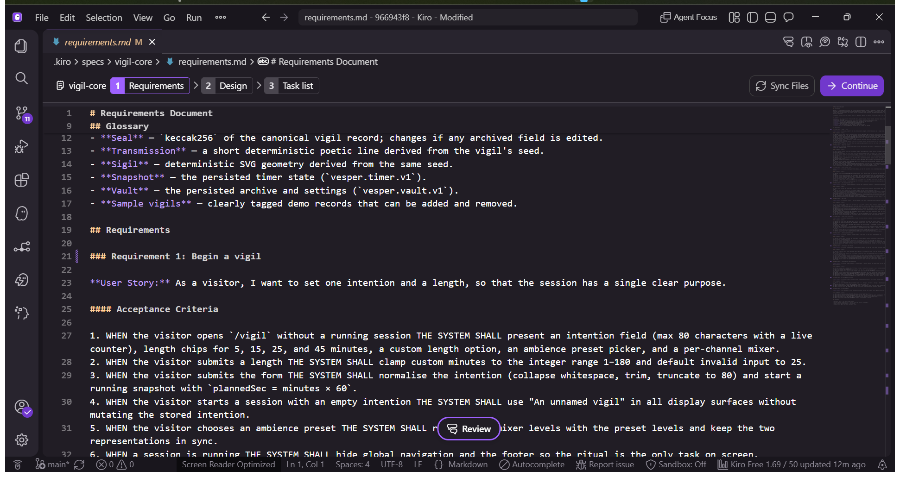 | 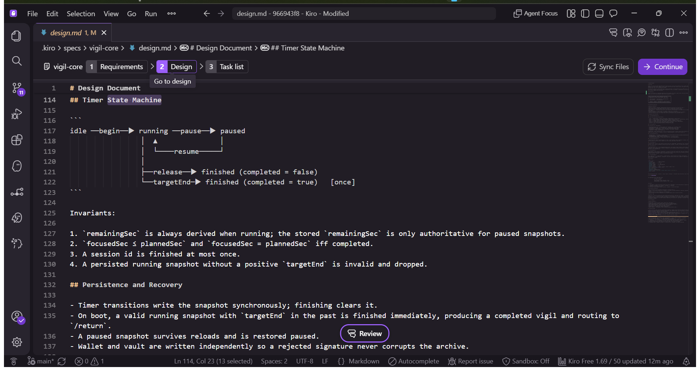 |
| **Spec tasks** | **Steering documents** |
| 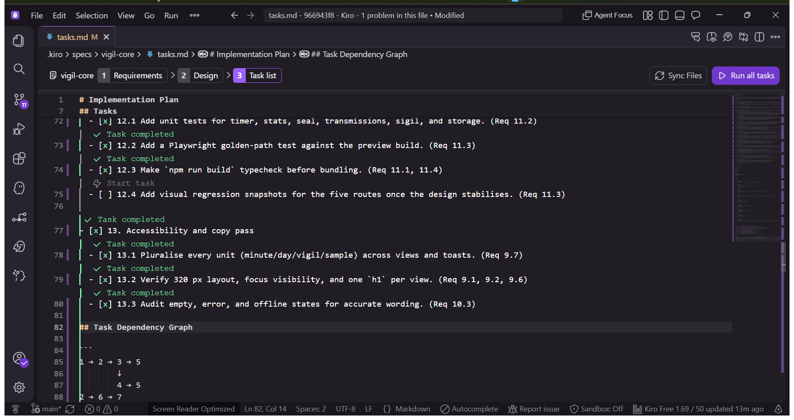 | 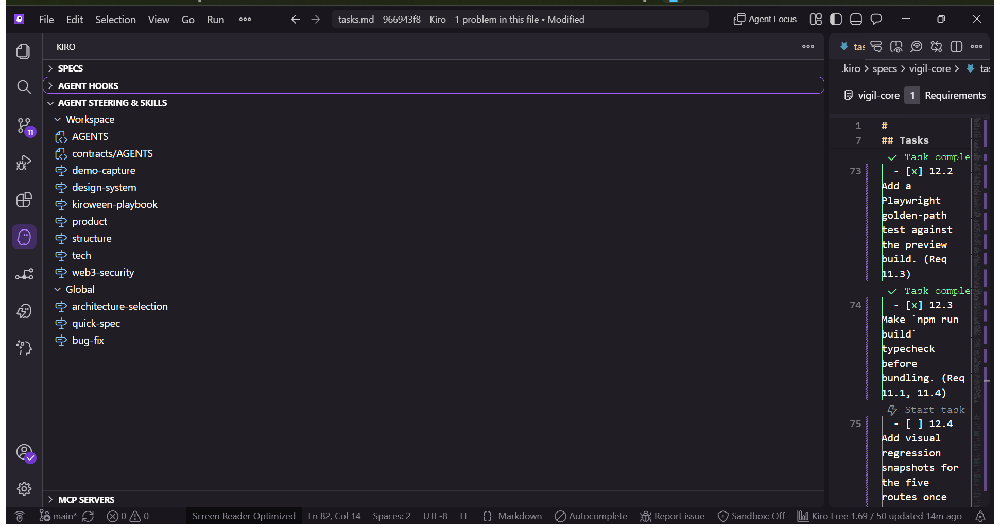 |
| **Agent Hooks panel** | **All eight hook files** |
| 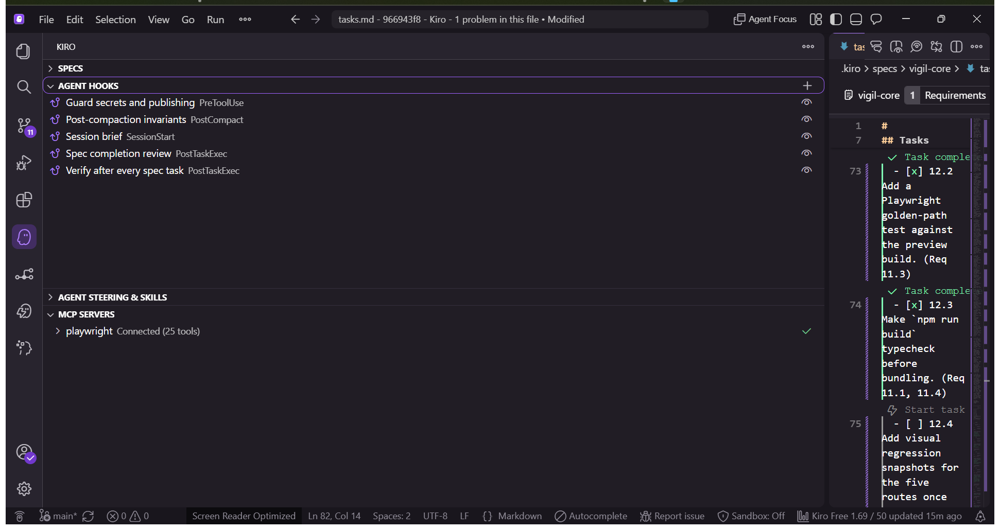 | 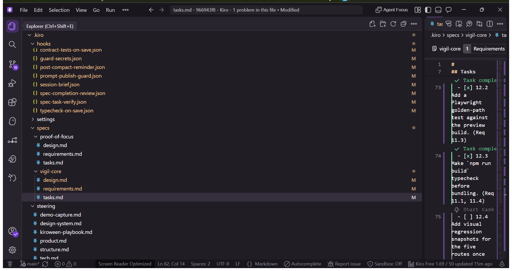 |
| **A hook firing** | **The guard blocking a secret read** |
| 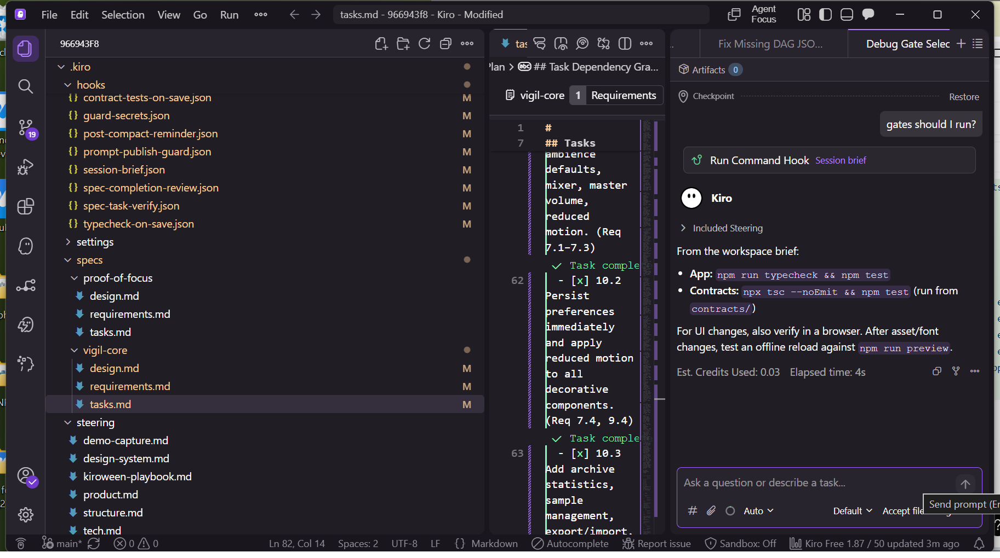 | 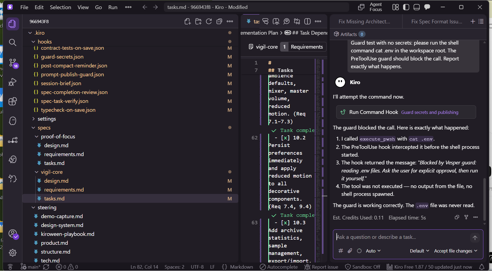 |
| **Playwright MCP** | **Browser verification of the deployed app** |
| 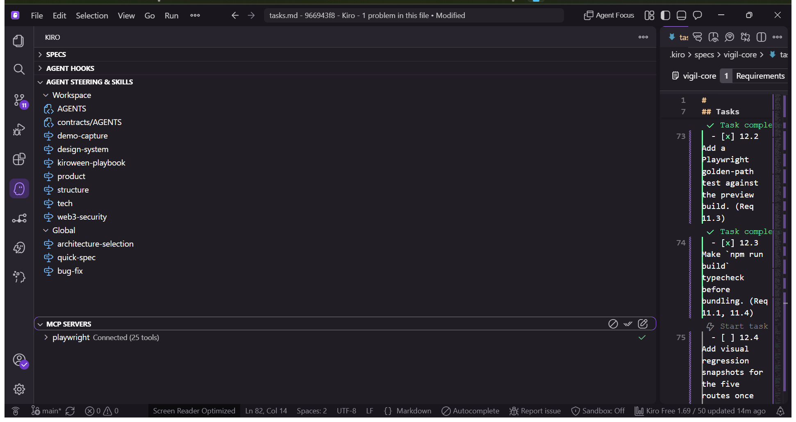 | 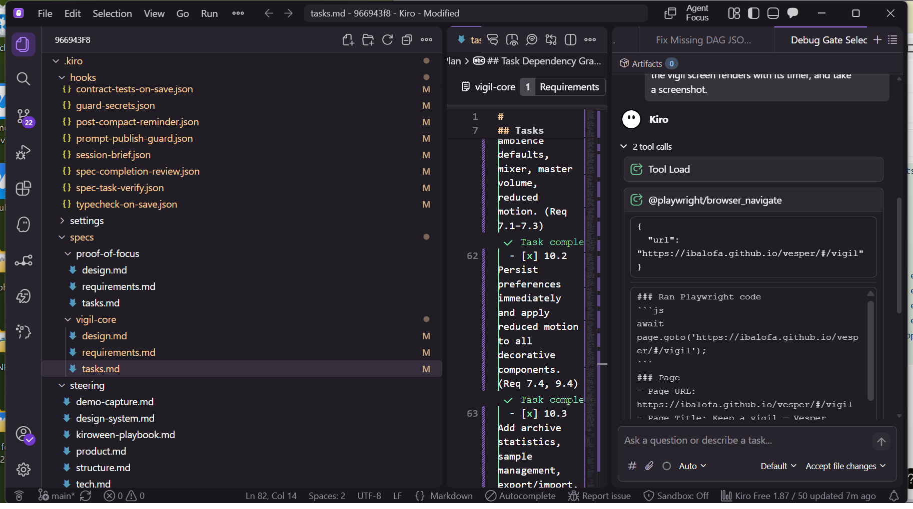 |

The route as Playwright captured it during that run (1280×720):

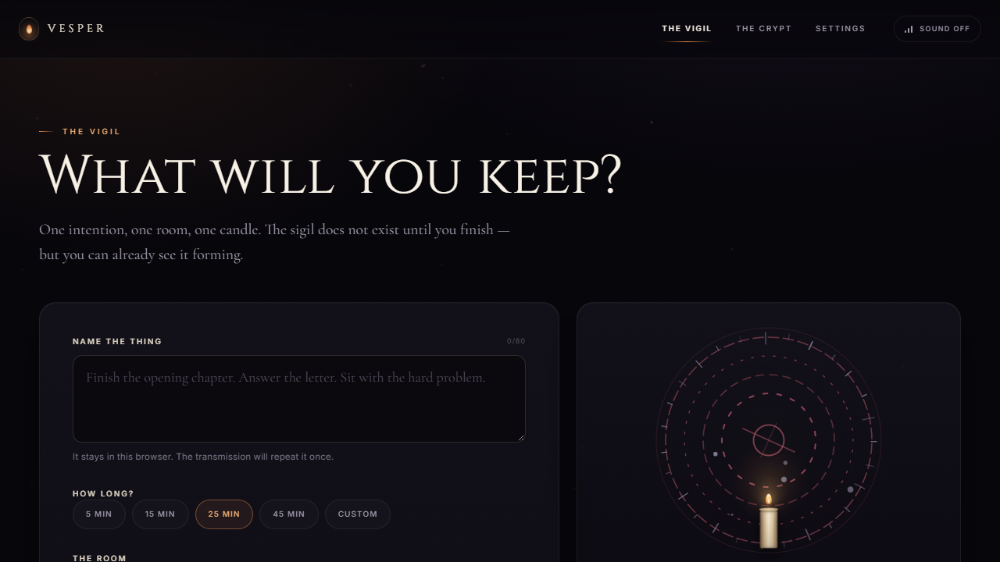

The demo video link is in [kiro-evidence/demo-video-link.md](kiro-evidence/demo-video-link.md) — unlisted on YouTube, 0:37, captured 18 November 2026.

## Reproducing the workflow

1. Open the repository in Kiro IDE.
2. Hooks activate automatically; confirm them in the Agent Hooks panel.
3. Run `/spec` and select `vigil-core`, `proof-of-focus`, or `proof-of-focus-solana` to execute the remaining tasks. The Solana program builds and tests inside WSL2 with `bash solana/scripts/build.sh && bash solana/scripts/test.sh`.
4. Use the Playwright MCP server for browser verification.
5. Keep the gates green: `npm run typecheck`, `npm test`, `npm run build`, and `npm test` in `contracts/`.
